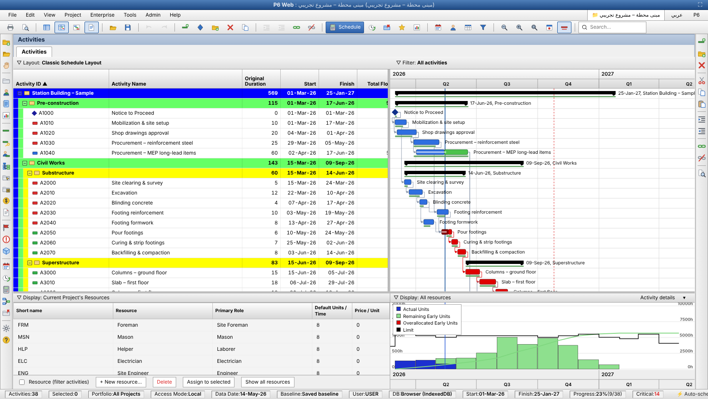

# P6 Web — Schedule Studio · استوديو الجدولة

A free, static web app (no build, no server, no data upload) that **opens, edits, schedules and exports Primavera P6 files** in the browser — and can be published on GitHub Pages.
تطبيق ويب ثابت ومجاني (بدون سيرفر وبدون رفع بيانات) **لفتح وتعديل وجدولة وتصدير ملفات Primavera P6** مباشرة من المتصفح، ويُنشر على GitHub Pages.

## الشكل / Look & feel

واجهة على طراز Primavera P6 Professional: شريط عنوان، قوائم File/Edit/View/Enterprise/Project/Tools/Admin/Help، تولبار، شريطا أدوات جانبيان، نافذة Activities مع **Layout / Filter**، صفوف WBS ملوّنة حسب المستوى مع شرائط جانبية، أشرطة Gantt بتسميات P6، ولوحة سفلية **Activity Details** أو **Resource Usage Profile** (جدول الموارد + Histogram). **كليك يمين** على الأنشطة والـ Gantt وعناوين الأعمدة وجدول الموارد (قص/نسخ/لصق، Assign Predecessors/Successors/Resources/Calendar/Constraint، Progress، Select، Indent…).



## نوافذ P6 وقوائمها الكاملة / Windows & full menus

* **نوافذ** بتبويبات علوية مثل P6: Projects, Resources, Activities, Resource Assignments, WBS, Expenses, WPs & Docs, Thresholds, Issues, Risks (من قائمة Project / View ← Show on Top أو الشريط الأيسر).
* **Resources**: ID / الاسم / النوع / وحدة القياس / الدور / Default Units + تبويبات General / Details / **Units & Prices** (أسعار بتاريخ سريان) / Roles / Notes / UDF. **Resource Assignments**: مجمّعة حسب Cost Account مع جدول زمني للوحدات والتكلفة.
* **Edit**: Cut/Copy/Paste, Add, Delete, **Dissolve**, **Renumber Activity IDs**, Assign ▸, Link/Unlink, **Fill Down** (Ctrl+E), Select All, **Find / Find Next / Replace** (Ctrl+F / F3 / Ctrl+R), Spell Check (F7), User Preferences.
* **Project**: Activities, Additional Activities View, Resource Assignments, WBS, **Assign / Maintain Baselines** (عدة بيزلاين ورئيسي)، Expenses, WPs & Docs, Thresholds (مراقبة تنشئ Issues)، Issues, Risks, Set Default Project.
* **View**: Layout ▸ (Open / Save / Save As)، Show on Top/Bottom، Bottom Layout Options، Bars، Columns، Time Scale، Filter By، Group and Sort، Progress Spotlight، **Progress Line**، Attachments، Line Numbers، Critical Path (driving)، **Check Schedule**، Table Font and Row، **Trace Logic** (Activity Network)، Hint Help، Status Bar، Zoom، Expand/Collapse/Collapse To، Toolbars.
* لا يوجد: Launch (تطبيقات P6 الأخرى)، Lock Toolbars، قاعدة بيانات مشتركة/Access Mode (التطبيق محلي بالكامل). بيزلاين متعدد، Issues، Thresholds، Risks، Docs وDiscussion تُحفظ في المتصفح/JSON فقط وليس في XER.

## Schedule / Filters / Group and Sort / قوائم Tools-Enterprise-Admin
- **Schedule (F9)**: نافذة P6 (Data Date، Forecast start، Log to file/HTML، Overwrite/Append، View Log، **Options**: Retained Logic / Progress Override، Critical = Total Float أو Longest Path، Lag calendar، Total Float from).
- **Filters**: Default / Global / User Defined، اختيار أكثر من فلتر مع All / Any، New/Modify لبناء فلتر بشروط، Make Global.
- **Group and Sort**: حتى 8 مستويات (WBS بمستوياته، Status، Float، Activity Codes…)، ألوان وإزاحة وإجماليات، وSort متعدد. عمود Page Break موجود (يظهر كخط فاصل في المعاينة وينفّذ فاصل صفحة عند الطباعة من المتصفح).
- أزرار شريط الأدوات بأسهم منسدلة (Bars, Columns▾, Timescale, Filter▾, Group&Sort▾, #▾) وقوائم Layout وزر الفأرة الأيمن على الـ Gantt.
- قوائم Tools / Enterprise / Admin بنفس ترتيب P6. الميزات الفعلية: Schedule, Check Schedule, Apply Actuals, Update Progress, Recalculate Costs, Global Change, Thresholds, Issues, Reports, Calendars, Codes, UDF, Roles, Cost Accounts. أما Level Resources وSummarize وVisualizer وPublish وEPS/OBS وغيرها فمعروضة في القائمة لكنها تظهر رسالة أنها غير متاحة في النسخة الثابتة.

## الأيقونات والقوائم والتفاصيل / Icons, File menu, Activity Details

* أيقونات **ملوّنة** بطراز P6 في التولبار والشريطين الجانبيين والقوائم (مجموعة SVG مرسومة داخل `js/icons.js`).
* قائمة **File** كاملة: New / Open / Close All / Page Setup / Print Setup / Print Preview / Print / Import ▸ / Export ▸ / Send Project / Select Project Portfolio / Commit Changes (F10) / Refresh Data (F5) / Recent Projects ▸ / Exit. الطباعة بمعاينة حقيقية للجدول + Gantt.
* **Activity Details** بـ16 تبويباً: General, Status, Resources, Predecessors, Successors, Codes, Notebook, Steps, Feedback, WPs & Docs, Expenses, Summary, Relationships, Risks, User Defined Fields, Discussion — مع نافذة **Customize** (Available Tabs / Display Tabs) بالنقر يمين على شريط التبويبات.
* شريط الحالة: Portfolio / Access Mode / Data Date / Baseline / User / DB.
* الدفتر (Notebook) والمصروفات (Expenses) تُصدَّر إلى XER؛ أما WPs & Docs وRisks وDiscussion فتُحفظ في المتصفح وملف JSON الاحتياطي فقط.

## نافذة Columns وكل أعمدة P6 / Columns dialog

نافذة **Columns** بنفس تصميم P6 (Available Options شجرة بفئات + Selected Options + ▶ ⏩ ◀ ⏪ + ▲▼ + OK / Cancel / Apply / Copy From / Default / Edit Column / Help) مع **أكثر من 120 عموداً** حقيقياً: Activity Codes (Global/Project)، Activity Steps، Costs، Dates، Durations، Earned Value (PV / EV / AC / SV / CV / SPI / CPI / EAC / ETC / VAC / TCPI)، Feedback، General، Lists، Multiple Float Paths، Number of Activities، Percent Completes (Duration / Physical / Units / Cost / Schedule / Performance)، Project Codes، Units، User Defined.
التكاليف تُحسب من **سعر الوحدة** للموارد × الوحدات المعيّنة، والـ PV من بيانات البيزلاين. من قائمة **Admin** تعرّف أكواد الأنشطة والمشروع وحقول المستخدم، وتُعيَّن من تبويبات **Codes / Steps / Feedback / User Defined** في التفاصيل. كل ذلك يُقرأ ويُكتب في ملف XER (ACTVTYPE / ACTVCODE / TASKACTV / PCATTYPE / UDFTYPE / UDFVALUE / TASKPROC / RSRCRATE / PROJCOST…).

## ما الذي يقدّمه / Features

| | |
|---|---|
| **استيراد / Import** | XER (كل المشاريع داخل الملف مع اختيار المشروع)، PMXML، JSON، CSV / لصق من Excel |
| **Gantt** | أشرطة مثل P6: المسار الحرج (أحمر)، البيزلاين تحت كل شريط، التقدّم، Milestones، خطوط العلاقات FS/SS/FF/SF، Data Date، اليوم، Float، تكبير/تصغير بالعجلة (Ctrl) |
| **جدول الأنشطة** | تجميع حسب WBS (طي/فتح)، تعديل أي خلية بالنقر المزدوج / F2 / الكتابة، أعمدة قابلة للإظهار والترتيب والتحجيم، فرز، بحث وفلاتر (حرجة، قيد التنفيذ، متأخرة عن البيزلاين، فلوت سالب) |
| **CPM** | محرك جدولة: تقاويم (أيام العمل + الإجازات)، Lag سالب/موجب، قيود (Start/Finish On or After/Before، Mandatory، ALAP)، Total/Free Float، كشف الحلقات المنطقية، Retained Logic / Progress Override |
| **البيزلاين والتحديث** | حفظ الجدول كبيزلاين، استيراد بيزلاين من XER قديم، **تحديث التقدّم** (Data Date + بداية/نهاية فعلية + %) مع "تقدّم تلقائي حسب الخطة"، استيراد XER محدَّث مع الاحتفاظ بالبيزلاين، أعمدة الانحراف، منحنى S |
| **تحرير بالسحب** | اسحب الشريط لتحريكه، حافته لتغيير المدة، النقطة الصغيرة في نهايته إلى شريط آخر لعمل علاقة؛ اسحب الصفوف لنقلها بين WBS |
| **أخرى** | تراجع/إعادة (60 خطوة)، حفظ تلقائي في المتصفح (IndexedDB) لعدة مشاريع، تقاويم، WBS، موارد وتعيينات، ثيم فاتح/داكن، عربي/English، طباعة |
| **تصدير / Export** | **XER** (يُفتح في P6)، CSV (Excel)، JSON نسخة احتياطية |

## التشغيل محلياً / Run locally

```bash
cd p6-web && python3 -m http.server 8000     # then open http://localhost:8000
```
(أو افتح `index.html` مباشرة؛ كل شيء يعمل بدون سيرفر.)

## النشر على GitHub Pages / Publish

الموقع منشور تلقائياً من workflow الـ Pages الموجود في المستودع على المسار **`/p6-web/`**
(`https://<user>.github.io/<repo>/p6-web/`) عند الدمج في `main`.
لنشره كموقع مستقل: انسخ مجلد `p6-web` إلى مستودع جديد ← Settings → Pages → Deploy from branch → `/ (root)`.

## سير عمل البيزلاين والتحديث / Baseline & update workflow

1. **ملف ← فتح ملف** واختر ملف XER الأساسي (البيزلاين) ← **المشروع ← البيزلاين ← حفظ الجدول الحالي كبيزلاين**.
2. عند وصول التحديث: **ملف ← استيراد تحديث (XER) مع الاحتفاظ بالبيزلاين** — تظهر أشرطة البيزلاين أسفل أشرطة التحديث وأعمدة الانحراف.
   (أو: أدخل التقدّم يدوياً من **المشروع ← تحديث التقدّم**، ثم **تطبيق وجدولة**.)
3. **التقارير** لمنحنى S وأكبر التأخيرات، ثم **ملف ← تصدير XER**.

## ملاحظات مهمة / Notes & limitations

* الجدولة إعادة تنفيذ لـ CPM **على مستوى اليوم**. عند فتح XER تُعرض التواريخ كما هي في الملف، وعند أول تعديل (أو F9) تُعاد الحساب وتظهر رسالة بعدد الأنشطة التي اختلفت تواريخها عن P6. الحالات المتقدمة (توزيع الموارد Leveling، تقاويم بالساعات، LOE/WBS Summary، علاقات بين مشاريع) قد تختلف قليلاً — راجع المخرجات الحرجة في P6.
* ملف XER المُصدَّر يحافظ على باقي جداول الملف الأصلي (الأكواد، OBS، العملات… إلخ) ويُحدّث جداول المشروع/WBS/الأنشطة/العلاقات/التقاويم/الموارد. جرّب استيراده في P6 مع نسخة تجريبية أولاً.
* لا يوجد في هذه النسخة: تعيين موارد بالتكلفة، Activity Codes، Steps، Notebook Topics، تصدير PMXML.
* ملفات `samples/station-sample.xer` مثال جاهز للتجربة.

## الاختبارات / Tests

```bash
node p6-web/tests/engine.test.js
```
